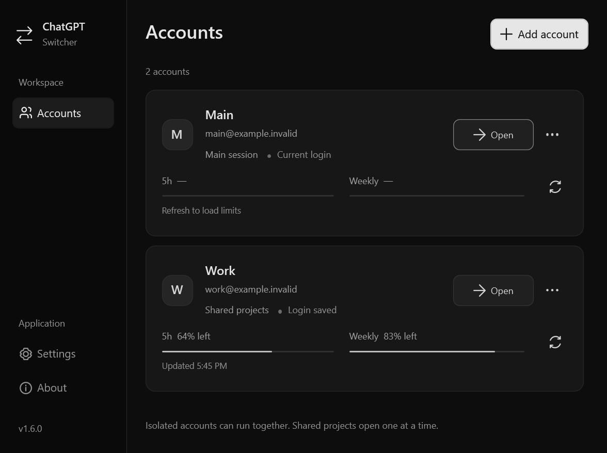



# ChatGPT Switcher

### Your accounts, ready when you are.

A compact Windows app for switching ChatGPT / Codex desktop accounts.  
Real profile pictures. Live usage limits. Shared projects or separate workspaces.

[**Download for Windows**](https://github.com/Exyywtf/chatgpt-switcher/releases/latest) · [Report a bug](https://github.com/Exyywtf/chatgpt-switcher/issues) · [Original Japanese README](README.ja.md)

Actual WPF interface with fictional accounts and example usage. Personal details and credentials are excluded from this screenshot.

## What you get

| | |
|---|---|
| **Switch accounts** | Open a saved account from the picker. Shared switching fully stops the desktop process tree before restoring the selected login and reopening the app. |
| **Keep your projects** | Shared projects use the same local Codex chats, projects, context and settings across accounts. |
| **Separate workspaces** | Isolated profiles have their own Electron data and Codex home, and can run side by side. |
| **See who is signed in** | Names, emails, ChatGPT profile pictures, saved-login status and running indicators. |
| **Check your limits** | Five-hour and weekly Codex capacity remaining, reset-time tooltips and a refresh button on every card. |
| **Windows integration** | Account shortcuts, tray mode, startup integration and command-line options. |
| **A calmer interface** | Near-black surfaces, rounded cards, thin vector icons and short animations that follow Windows accessibility preferences. |

## Download and open

1. Download **ChatGPT-Switcher-windows-x64.zip** from [Releases](https://github.com/Exyywtf/chatgpt-switcher/releases/latest).
2. Extract it to a folder you want to keep.
3. Open **ChatGPT-Switcher.exe**.

Requires Windows 10 or 11 **x64**, Windows PowerShell 5.1, .NET Framework 4.8, and the supported desktop app installed. The currently tested desktop package is OpenAI.Codex. Other app variants may not expose compatible authentication or launch behavior.

The EXE is a small launcher with the PowerShell application embedded inside. It uses Windows' built-in PowerShell and WPF. On first run it writes application files to <code>%LOCALAPPDATA%\ChatGPTSwitcher\app</code>. No administrator access is required.

**This release is unsigned.** Windows SmartScreen may display a warning. Verify the downloaded file against the published SHA-256 checksums before running it.

## Set up shared accounts

1. With your original account signed in, open **Main → Account options → Save current login as Main**. Check the email before confirming.
2. Choose **Add account → Shared projects**. Sign into that account manually in the desktop app, then choose its **Account options → Save current login**.
3. Choose **Open** on either saved account whenever you want to switch.

**Save in-progress work before switching.** The switcher ends the shared desktop process and its child processes to release the old login completely. Separate Codex CLI or IDE sessions may need to be closed manually. The picker stays open after a successful switch.

An unsaved account shows setup instructions. Main is saved separately so it can be restored correctly.

### Shared or isolated?

| | Shared projects | Isolated |
|---|---|---|
| Local chats, projects and context | Shared | Separate |
| Local settings | Shared | Separate |
| Authentication | Saved per profile and restored when switching | Stored in each isolated home |
| Simultaneous use | One shared desktop account | Multiple isolated accounts |
| Cloud account data and billing | Belong to each signed-in account | Belong to each signed-in account |

## Usage and profile pictures

Initially visible cards load usage and profile pictures in the background. Use the card's **refresh icon** to update them again. Usage meters show **capacity remaining** in the Codex five-hour and weekly windows. Hover over a reading to see its next reset time.

Pictures come from the authenticated ChatGPT profile after its email matches the saved login. Unavailable images fall back to initials. Images and usage readings are cached in memory. There is no periodic network polling.

Expired sessions may require opening the account and saving its login again. Missing quota windows show a dash. API-key logins do not expose these ChatGPT quota windows. Request failures retain earlier readings with error feedback.

## Your local data

Account settings and saved logins live under <code>%USERPROFILE%\ChatGPT-Accounts</code>. Shared mode uses <code>%USERPROFILE%\.codex</code>, including atomic authentication replacement and a previous-login backup. File-based authentication is supported. Explicit keyring, auto or ephemeral credential-store settings are rejected.

Saved authentication is sensitive. Do not upload account folders, auth.json, authentication backups, cookies, or full diagnostics containing private information.

For usage and profile requests, the app sends the selected account's access token only to authenticated ChatGPT backend routes. Supported image hosts receive image requests without those credentials. These desktop-service interfaces can change.

Removing an isolated account deletes its local profile data. Removing a shared profile deletes its saved snapshot, while its shared Codex home stays in place.

## Build from source

~~~powershell
powershell.exe -NoProfile -ExecutionPolicy Bypass -File .\build.ps1
~~~

The executable appears in <code>dist\ChatGPT-Switcher.exe</code>. The build uses Windows' .NET Framework C# compiler, embeds the application and license, and creates no debug symbols.

You can also run **ChatGPT-Switcher.cmd**, or use the script with Windows PowerShell 5.1 / PowerShell 7 in STA mode.

~~~powershell
ChatGPT-Switcher.exe -Version
ChatGPT-Switcher.exe -List
ChatGPT-Switcher.exe -Launch Work
ChatGPT-Switcher.exe -Tray
ChatGPT-Switcher.exe -Diagnose
ChatGPT-Switcher.exe --license
~~~

## Tested and still to verify

The WPF picker, menus, dialogs, responsive layouts, shared authentication backend, usage requests and profile retrieval have fixture regression coverage under Windows PowerShell 5.1 and PowerShell 7. Shared switching, real usage and real profile images have also been exercised on the development machine.

Long-term session expiry, every desktop-app version, startup on a fresh Windows installation, and all VS Code integration scenarios still need wider testing. Treat this as an early public release.

## Connect

Made by **Exyy**.

- Instagram — [@exyywtf](https://www.instagram.com/exyywtf/)
- Discord — **@exyy**

Copyright © 2026 Exyywtf for modifications. Distributed under the [MIT license](LICENSE).

Unofficial community software. Not affiliated with or endorsed by OpenAI. OpenAI and ChatGPT branding belongs to its respective owner.
